<p align="center">
  
</p>

<p align="center">
  <a href="https://veljkoivic.ch"></a>
  &nbsp;
  <a href="https://www.linkedin.com/in/veljko-ivic/"></a>
  &nbsp;
  <a href="https://veljkoivic.ch/assets/Resume_Veljko-Ivic_EN.pdf"></a>
</p>

<!-- 💼 Optional – Kommentarzeichen entfernen, wenn Recruiter das sehen sollen:
<p align="center"><b>💼 Open to software engineering opportunities (C# / .NET)</b></p>
-->

<br />

I build practical software with a strong focus on **structure, simplicity and real-world usability**.
Before I wrote code, I wired buildings – first as a certified electrician, today as a junior project manager in electrical engineering.
That background shapes how I work: **plan carefully, build cleanly, document everything – and make sure it actually works in the field.**

<p align="center">
  ⚡ <b>Electrician EFZ</b> &nbsp;→&nbsp; 📐 <b>Junior Project Manager</b> &nbsp;→&nbsp; 🎓 <b>Computer Science HF</b> &nbsp;→&nbsp; 🚀 <b>Software Engineer</b> <sub><i>(loading…)</i></sub>
</p>

```csharp
public sealed class Veljko : IDeveloper
{
    public string   Role     => "Junior Project Manager · Electrical Engineering";
    public string   Studying => "Computer Science (HF) @ HF Uster";
    public string   Location => "Zurich, Switzerland";

    public string[] Stack    => ["C#", ".NET", "ASP.NET Core", "Blazor", "WPF", "PostgreSQL"];
    public string   Focus    => "Software architecture & bridging business and tech";

    public bool     LovesCleanCode => true;
}
```

## Tech stack

<p align="center">
  
</p>

## Selected projects

<table>
  <tr>
    <td colspan="2" valign="top">
      <h3>💰 Monella</h3>
      <p>Finance &amp; receipt management web app – budgets, accounting and digital receipts with <b>warranty reminders</b>. My HF diploma thesis, built with a full software-engineering process and accessibility in mind (WCAG 2.2 AA).</p>
      <p><code>Blazor</code> <code>ASP.NET Core</code> <code>PostgreSQL</code> <code>Docker</code></p>
      <sub>🟡 In progress · Diploma thesis</sub>
    </td>
  </tr>
  <tr>
    <td width="50%" valign="top">
      <h3>🎣 Fisher Tech Service</h3>
      <p>Website for a Swiss fishing rod &amp; reel service – concept, design and build. Next up: a dashboard that tracks which spare parts fit which reel models, so <b>shared parts live in one place</b> instead of twenty separate lists.</p>
      <p><code>Astro</code> <code>Sass</code> <code>Bulma</code></p>
      <sub>🟢 Website live · <a href="https://www.fishertechservice.ch">fishertechservice.ch ↗</a></sub>
    </td>
    <td width="50%" valign="top">
      <h3>🧠 Algorithm Practice</h3>
      <p>LeetCode problems and C# exercises – sharpening algorithms, data structures and clean fundamentals, one problem at a time.</p>
      <p><code>C#</code> <code>LeetCode</code></p>
      <sub>🔵 Ongoing</sub>
    </td>
  </tr>
</table>

<p align="center"><sub><a href="https://github.com/VeljkoIvic?tab=repositories">See all repositories →</a></sub></p>

## Activity

<p align="center">
  
</p>

## Off the keyboard

- 🏴‍☠️ **One Piece** – the anime *and* the trading card game (yes, I build competitive decks)
- 🎣 **Fishing** – and repairing fishing reels
- 🏃 **Running** – currently training for a marathon
- 🗾 **Japanese** – learning it just out of curiosity

<br />

<p align="center">
  <i>Thanks for stopping by – let's build something that solves a real problem.</i>
  <br /><br />
  
</p>


